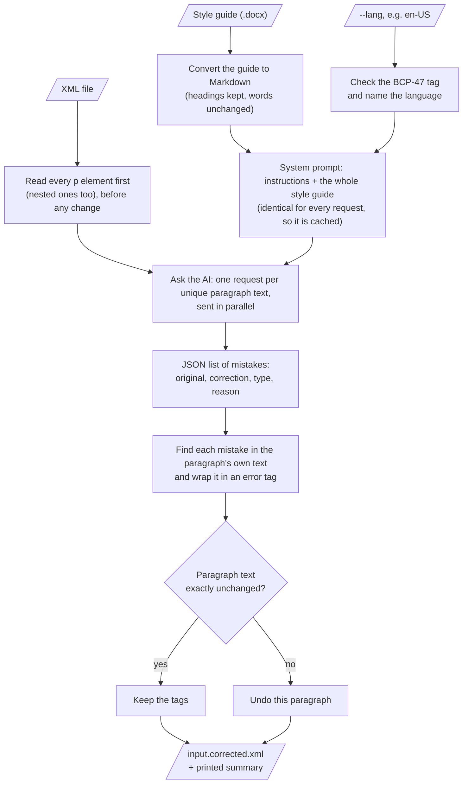

# XML Proofreader

A command-line tool that proofreads the `<p>` elements of an XML file with a GenAI model
(OpenAI or Anthropic) and **marks** each mistake with an `<error>` tag. It never rewrites the text:

```xml
<p>My name is <error type="capitalization" correction="John" reason="Names start with a capital letter">john</error>.</p>
```

Error types: `grammar`, `spelling`, `punctuation`, `capitalization`, `clarity`, `styleguide`.
Only `<p>` text is checked; headings and everything else are left exactly as they are.

This README covers setup and use. How the tool is built, with diagrams, is explained in
[docs/](docs/README.md); see [Documentation](#documentation) for which page covers what.

## Setup

Requires Python 3.10+ and [uv](https://docs.astral.sh/uv/).

```bash
uv sync                     # creates .venv with the locked dependencies
cp .env.example .env        # Windows: copy .env.example .env
```

Then put your API key in `.env`: `OPENAI_API_KEY=...` (the default provider) or `ANTHROPIC_API_KEY=...`.

Without uv:

```bash
python -m venv .venv && source .venv/bin/activate   # Windows: .venv\Scripts\activate
pip install -r requirements.txt pytest
```

## Run

```bash
uv run python main.py examples/sample_input.xml --lang en --style-guide examples/Style_Guide.docx
uv run python main.py examples/sample_input.xml --lang en-US --style-guide examples/Style_Guide.docx --provider anthropic
```

| Option | Meaning |
| --- | --- |
| `input` | The XML file to proofread |
| `--lang` | BCP-47 language tag, e.g. `en`, `en-US`, `en-GB`, `fr`. Spelling follows the region (`organisation` is fine for `en-GB`, an error for `en-US`; plain `en` accepts both). The style guide is written for English, so for other languages only the rules that make sense for that language are applied |
| `--style-guide` | House style rules as a `.docx` file |
| `--provider` | `openai` (default, model `gpt-6.1-terra`) or `anthropic` (model `claude-opus-5-5`) |
| `--model` | Use a different model of that provider (overrides `OPENAI_MODEL` / `ANTHROPIC_MODEL` in `.env`) |
| `--workers` | Requests sent at the same time (default `LLM_WORKERS` or 8) |
| `--verbose` | Show debug messages |

The result is written next to the input as `<input-name>.corrected.xml`, and a summary is printed
(paragraphs checked, errors by type, skipped mistakes, AI requests and tokens, time per step, peak memory).
`examples/sample_input.corrected.xml` is the output of a real run with `gpt-6.1-terra` and `--lang en-US`.

Example summary for `examples/sample_input.xml` (14 paragraphs):

```text
Paragraphs: 14 total, 14 checked, 14 with errors
  left unchanged: 0 empty, 0 with CDATA, 0 failed AI requests, 0 undone by the safety check
Errors marked: 47 (clarity 1, grammar 8, punctuation 6, spelling 3, styleguide 29)
Mistakes skipped as unsafe: 0
AI: 14 requests, 14 attempts; tokens: 47,588 in (47,546 cached), 1,741 out
Time: style guide 0.14s, read 0.00s, ai 5.99s, mark 0.00s, save 0.00s; total 6.23s
Peak memory: 197.5 MB process, 4.1 MB Python objects
```

Memory is shown for the whole process and for Python objects; on Windows only the second is available.
Exit code is `0` on success and `1` on an error such as a bad `--lang`, a missing file or a bad API key.

Optional settings in `.env` (see `.env.example`; a setting left empty uses its default):

| Setting | Default | Meaning |
| --- | --- | --- |
| `OPENAI_MODEL` | `gpt-6.1-terra` | OpenAI model (the `--model` flag overrides it) |
| `OPENAI_REASONING_EFFORT` | `low` | How much a reasoning model (gpt-5, gpt-6, o-series) thinks: `none`, `low`, `medium`, `high`, `xhigh`, `max`. Older models such as `gpt-4.1` run with temperature 0 instead |
| `ANTHROPIC_MODEL` | `claude-opus-5-5` | Anthropic model (the `--model` flag overrides it) |
| `ANTHROPIC_MAX_TOKENS` | `16000` | Most tokens Claude may use per paragraph (thinking plus answer) |
| `LLM_WORKERS` | `8` | Requests sent at the same time |
| `LLM_MAX_ATTEMPTS` | `3` | Tries per paragraph when an answer can't be parsed |
| `LLM_RATE_LIMIT_RETRIES` | `3` | Waits and retries when the provider reports too many requests |
| `LLM_RATE_LIMIT_WAIT` | `10` | First wait in seconds (doubles each time, max 120) |

More detail: [Configuration](docs/configuration.md) (every option, `--lang` examples, the summary
line by line, exit codes).

## Run with Docker

No Python or uv needed, only [Docker](https://docs.docker.com/get-docker/):

```bash
docker build -t xml-proofread .        # build the app image
docker build --target test .           # run the tests inside Docker (no API key needed)

docker run --rm --env-file .env -v "$PWD:/data" xml-proofread \
  examples/sample_input.xml --lang en-US --style-guide examples/Style_Guide.docx
```

- `-v "$PWD:/data"` shares the current folder with the container, so paths work as above and
  the `.corrected.xml` file is written next to the input on your machine.
- `--env-file .env` passes the API key and settings. The key is never built into the image.
- On Linux, add `--user "$(id -u):$(id -g)"` if the output can't be written to the shared folder.

## How it works



1. All `<p>` elements are read first (nested ones too), before anything changes.
2. The style guide is converted to Markdown once and sent, complete, in the system prompt. That prompt
   is identical for every request, so it is served from the prompt cache.
3. Each unique paragraph is sent to the AI once, in parallel. No style rules are written into the
   code: the AI applies the style guide it was given, so any `.docx` guide works. The AI answers
   with JSON only: `{"errors": [{"original", "correction", "type", "reason"}]}`.
4. Our code finds each `original` in the paragraph and wraps it in `<error>`.
5. A safety check confirms the paragraph's text is unchanged; if not, the paragraph is restored.

### Example: one paragraph, step by step

From [examples/example_input.xml](examples/example_input.xml):

```xml
<p>The firm reported approximately $2,000,000 in revenue for January, 2024, and plans to expand it's publicly-owned subsidiaries in the coming fiscal year.</p>
```

The AI does not rewrite the paragraph. It only lists the mistakes, quoting each one exactly.
For this paragraph the answer looks like this (a real model may word the reasons differently):

```json
{"errors": [
  {"original": "$2,000,000", "correction": "$2 million", "type": "styleguide", "reason": "Spell out million, billion, etc."},
  {"original": "January, 2024", "correction": "January 2024", "type": "styleguide", "reason": "No comma between month and year"},
  {"original": "it's", "correction": "its", "type": "punctuation", "reason": "Possessive its has no apostrophe"},
  {"original": "publicly-owned", "correction": "publicly owned", "type": "styleguide", "reason": "Do not hyphenate ly adverbs"}
]}
```

Our code finds each `original` in the text and wraps it, leaving every character in place
(as in [examples/example_output.xml](examples/example_output.xml)):

```xml
<p>The firm reported approximately <error type="styleguide" correction="$2 million" reason="Spell out million, billion, etc.">$2,000,000</error> in revenue for <error type="styleguide" correction="January 2024" reason="No comma between month and year">January, 2024</error>, and plans to expand <error type="punctuation" correction="its" reason="Possessive its has no apostrophe">it's</error> <error type="styleguide" correction="publicly owned" reason="Do not hyphenate ly adverbs">publicly-owned</error> subsidiaries in the coming fiscal year.</p>
```

Remove the `<error>` tags and you get the input paragraph back, character for character.

More detail: [Architecture](docs/architecture.md) (layers and the full flow, with diagrams),
[AI integration](docs/ai-integration.md) (prompts, JSON answer, retries, rate limits, caching) and
[Style guide handling](docs/style-guide-handling.md) (how the `.docx` becomes part of the prompt).

Safety rules:

- The original text is never changed. Removing every `<error>` tag gives back the input exactly.
- A paragraph with no mistakes, and everything outside `<p>` (declaration, comments, CDATA,
  namespaces, attributes, whitespace), stays byte-for-byte identical.
- A mistake is skipped (with a warning) if its text can't be found, overlaps another mistake, or
  crosses a tag. A paragraph containing CDATA is skipped completely.
- One failed paragraph never stops the run: it is left unchanged and counted in the summary.

More detail: [XML handling and safety](docs/xml-handling-and-safety.md) (how `<p>` text is read,
how `<error>` tags are inserted, and how the original text is protected).

## Documentation

The [docs/](docs/README.md) folder explains how the tool is built and why. Diagrams render on GitHub
and in the VS Code Markdown preview.

| Page | Read it to learn | Goes deeper on (README section) |
| --- | --- | --- |
| [Architecture](docs/architecture.md) | The layers, how one run flows from start to end, threads and error handling | [How it works](#how-it-works) |
| [Codebase guide](docs/codebase-guide.md) | Where everything lives, the main data types, coding rules, how to make common changes | [Project layout](#project-layout) |
| [XML handling and safety](docs/xml-handling-and-safety.md) | How `<p>` text is read, how `<error>` tags are inserted, how the original text is protected | Safety rules in [How it works](#how-it-works) |
| [AI integration](docs/ai-integration.md) | The prompts, the JSON answer, provider settings, retries, rate limits and prompt caching | [How it works](#how-it-works), steps 2–3 |
| [Style guide handling](docs/style-guide-handling.md) | How the `.docx` style guide reaches the AI, and why no style rules are in the code | [How it works](#how-it-works), step 2 |
| [Configuration](docs/configuration.md) | Command-line options, `.env` settings, `--lang`, the summary and exit codes | [Run](#run) |
| [Testing](docs/testing.md) | How the tests run without an API key, and which tests must always pass | [Tests and code checks](#tests-and-code-checks) |
| [Design decisions](docs/design-decisions.md) | The main choices behind the design, and what they cost | [Known limitations](#known-limitations) |

New to the code? Read [Architecture](docs/architecture.md), then the [Codebase guide](docs/codebase-guide.md).

## Tests and code checks

```bash
uv run pytest -q              # tests (a fake AI: no network, no API key)
uv run ruff check .           # lint: likely bugs, imports, naming, docstrings and type hints
uv run ruff format .          # format the code the same way everywhere
```

More detail: [Testing](docs/testing.md).

## Project layout

| Path | Job |
| --- | --- |
| `main.py` | Command line only: reads the arguments, wires the parts together, prints the summary |
| `proof_read_process/` | The proofreading flow: `language` (check `--lang`), `rule_loader` (read the `.docx` style guide as Markdown), `prompts` (fill the templates), `xml_reader`, `ai_proofreader`, `error_marker`, `safety_check`, `report`, `pipeline` (`proofread_file()`) |
| `llms/` | AI clients, independent of proofreading: OpenAI / Anthropic via LangChain (`providers.create_llm`), parallel calls with re-asks (`llm_invoke`), rate-limit waits |
| `prompt_templates/xml_proofread/` | The system and user prompts (Markdown) |
| `utils/` | File reading/writing, `.env` settings, logging |
| `examples/` | Example input/output, sample input and the style guide |
| `tests/` | pytest tests |
| `Dockerfile` | Container image for the app; its `test` stage runs the tests |
| `docs/` | Architecture, codebase guide and design documentation, with diagrams |

More detail: [Codebase guide](docs/codebase-guide.md) (every file, the main data types and how to make common changes).

## Known limitations

- Markup that the XML library can't reproduce byte-for-byte (character references such as `&#x2019;`,
  single-quoted attributes, `<br></br>`) is saved as equivalent XML, with a warning.
- UTF-16 and UTF-32 files are not supported.
- A mistake that spans an inline tag (for example across `</b>`) is not marked.

Why these trade-offs were made: [Design decisions](docs/design-decisions.md).
