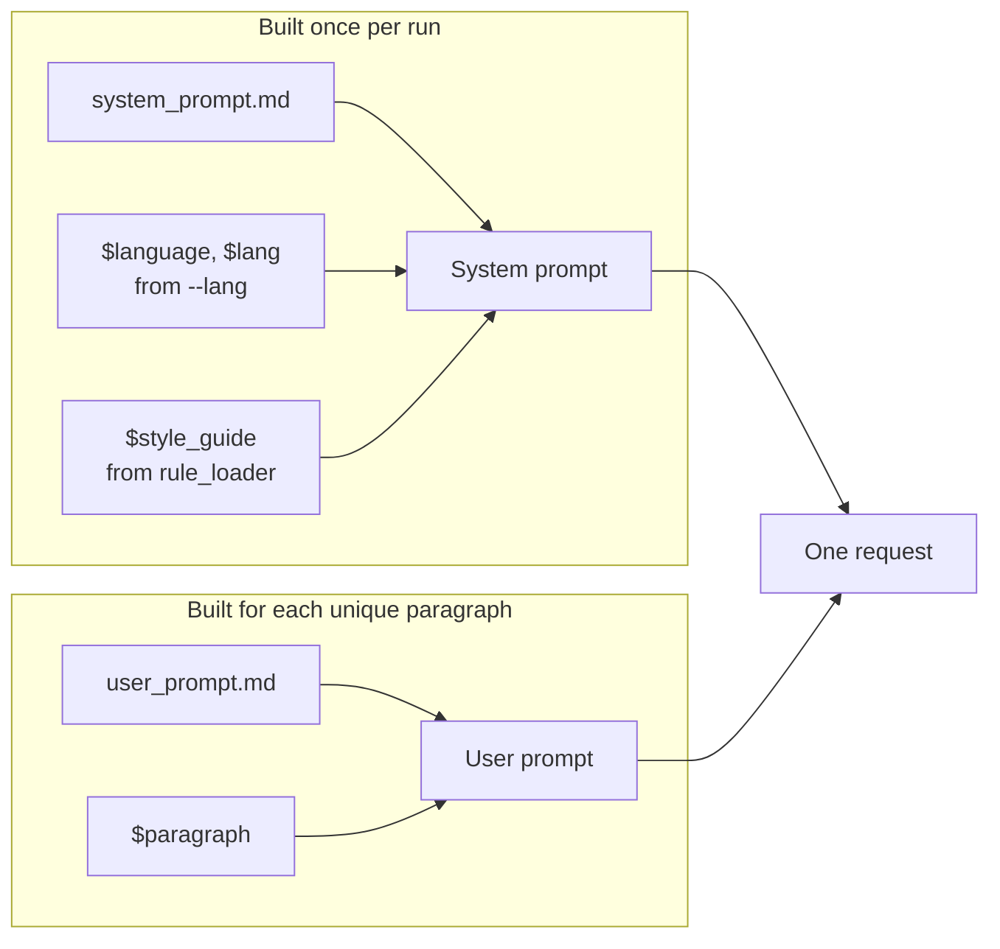
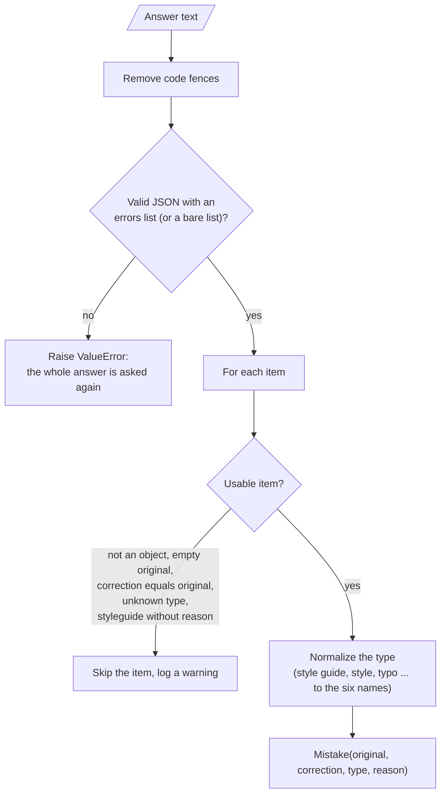
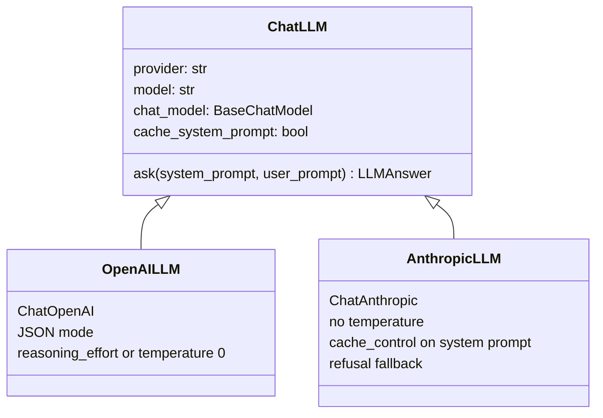
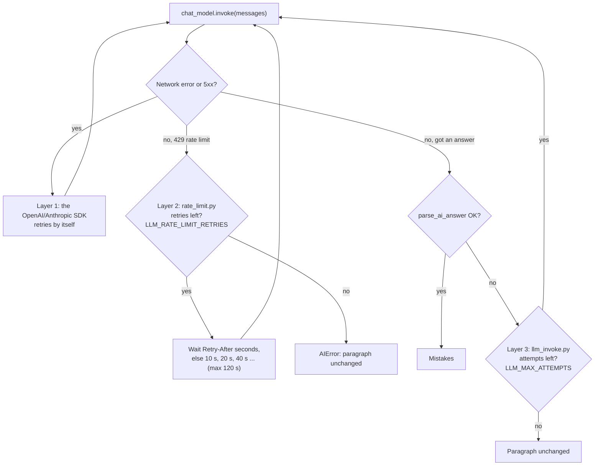
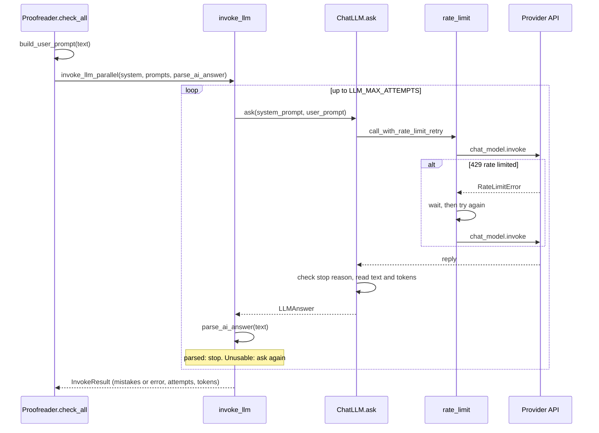

# AI integration

This page explains what is sent to the AI, what it must answer, how the answer is read, and
how failures are retried.

## The contract

The AI gets one paragraph at a time and answers with **JSON only**:

```json
{"errors": [
  {"original": "john", "correction": "John", "type": "capitalization", "reason": "Names start with a capital letter"}
]}
```

| Field | Rule |
| --- | --- |
| `original` | Copied **exactly** from the paragraph, as short as possible. Our code searches for it |
| `correction` | The replacement for `original` only. It goes into the `correction` attribute; the text itself is never changed |
| `type` | One of `grammar`, `spelling`, `punctuation`, `capitalization`, `clarity`, `styleguide` |
| `reason` | A short explanation. Required for `styleguide` (it must name the rule) |

Mistakes are listed in the order they appear and never overlap. No mistakes means
`{"errors": []}`.

## Prompts

Both prompts are Markdown templates in
[prompt_templates/xml_proofread/](../prompt_templates/xml_proofread/), filled with
`string.Template` by [prompts.py](../proof_read_process/prompts.py). Each template is read
from disk once per run.



| Template | Placeholders | Contents |
| --- | --- | --- |
| [system_prompt.md](../prompt_templates/xml_proofread/system_prompt.md) | `$language`, `$lang`, `$style_guide` | Role, the six error types, rules (copy `original` exactly, keep it short, never mark quoted material, apply the English style guide only where it fits the language, ...), answer format, a worked example, the full style guide |
| [user_prompt.md](../prompt_templates/xml_proofread/user_prompt.md) | `$paragraph` | The paragraph to check |

`string.Template` is used instead of `str.format` because the prompts contain JSON examples
with `{ }`. A literal `$` is written as `$$` in the templates (see the `$$3,000,000` example).

### Prompt caching

The system prompt is **identical for every request** in a run. Everything that changes per
paragraph is in the user prompt. This lets the provider serve the long system prompt (with
the style guide, about 2,500 tokens) from its cache:

- **OpenAI** caches long prompts automatically.
- **Anthropic** needs the system prompt marked with `cache_control`, which
  `ChatLLM.make_system_message()` does when `cache_system_prompt=True`.

Cached tokens are shown in the summary, for example `49,253 in (37,147 cached)`.

## Reading the answer

`parse_ai_answer()` in [ai_proofreader.py](../proof_read_process/ai_proofreader.py) turns the
answer text into `Mistake` objects.



Small problems are forgiven (code fences, a bare list, `"style guide"` for `"styleguide"`,
`"capitalisation"` for `"capitalization"`). Only an answer that is unusable as a whole is asked
again; one bad item is just skipped.

## Clients

All provider code is in [llms/](../llms/). Both providers use LangChain chat models, so they
share one interface (`chat_model.invoke`) and one error hierarchy.



| | OpenAI ([openai_llm.py](../llms/openai_llm.py)) | Anthropic ([anthropic_llm.py](../llms/anthropic_llm.py)) |
| --- | --- | --- |
| Default model | `gpt-6.1-terra` (default provider) | `claude-opus-5-5` |
| JSON | `response_format={"type": "json_object"}` always | Asked for in the prompt |
| Temperature | Reasoning models (`gpt-5*`, `gpt-6*`, `o1`, `o3`, `o4`, not `*chat*`) reject `temperature=0`, so they get `reasoning_effort` (`OPENAI_REASONING_EFFORT`, default `low`). Older models (`gpt-4.1`, `gpt-4o`) get `temperature=0` | Not sent: current Claude models reject it |
| Prompt caching | Automatic | `cache_control` on the system prompt |
| Output limit | Provider default | `ANTHROPIC_MAX_TOKENS` (default 16000, thinking plus answer) |
| Refusals | `refusal` / `content_filter` stop reason gives `AIError` | Server-side refusal fallback: `fallbacks="default"` with the `server-side-fallback-2026-07-01` beta |
| API key | `OPENAI_API_KEY` | `ANTHROPIC_API_KEY` |

`is_reasoning_model()` decides the OpenAI temperature setting in our code, because LangChain
only removes `temperature` for `gpt-5*` models.

`create_llm(provider, model)` in [providers.py](../llms/providers.py) picks the client. It
loads `.env` and treats an empty API key (`OPENAI_API_KEY=`) as missing, so the user sees a
clear "missing key" error instead of a confusing 401.

### Error sorting

`ChatLLM.ask()` ([base_llm.py](../llms/base_llm.py)) sorts every failure into one of two kinds:

| Kind | Examples | What happens |
| --- | --- | --- |
| `FatalAIError` | Bad API key, no permission, unknown model, missing key | The run stops. Requests not yet started are cancelled |
| `AIError` | Network or server error after the SDK's retries, rate limit after our retries, refusal, answer cut off (`max_tokens`, `length`), empty answer | That paragraph is left unchanged and the run goes on |

## Retries

There are three retry layers, each for a different problem.



1. **SDK** — network errors and 5xx are retried by the OpenAI and Anthropic SDKs. Our code does
   not add its own retries for these.
2. **Rate limits** — [rate_limit.py](../llms/rate_limit.py) waits and tries again on HTTP 429.
   It uses the `Retry-After` header when the provider sends one; otherwise it waits
   `LLM_RATE_LIMIT_WAIT` seconds (default 10), doubling each time, never more than 120 s.
3. **Unusable answers** — [llm_invoke.py](../llms/llm_invoke.py) asks again only when the answer
   can't be parsed, up to `LLM_MAX_ATTEMPTS` tries (default 3). An `AIError` is not retried
   here, because layers 1 and 2 already did.

## One paragraph, end to end


