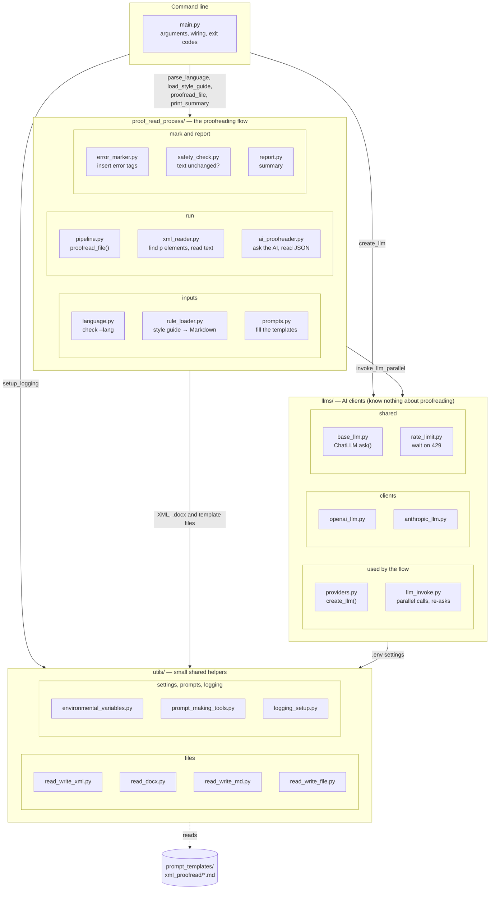
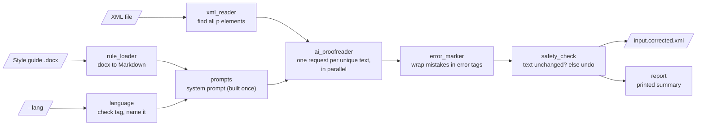
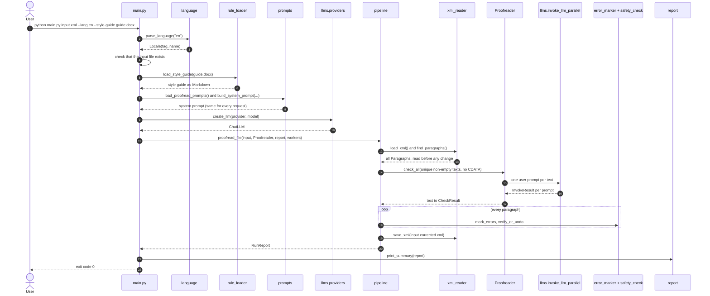
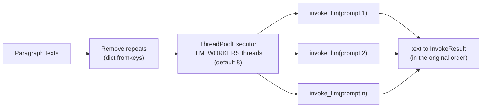
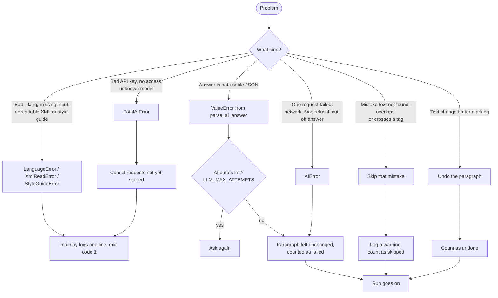

# Architecture

This page explains the parts of the XML Proofreader and how they work together.

## What the system does

The tool takes three inputs:

- an XML file,
- a language tag (`--lang`, BCP-47, for example `en-US`),
- a house style guide (`--style-guide`, a `.docx` file).

It sends the text of every `
` element to a GenAI model (OpenAI or Anthropic). The model
answers with a JSON list of mistakes. The tool then wraps each mistake in an `<error>` tag and
writes `<input-name>.corrected.xml` next to the input file.

Only `
` text is checked. Headings and all other elements are never sent to the AI.

## Layers

The code is split into four layers. Each layer only calls the layers below it.

| Layer | Job | Rule |
| --- | --- | --- |
| `main.py` | Reads the command line, builds the proofreader, turns expected errors into a one-line message and exit code `1` | The only Python file in the project root. No proofreading logic |
| `proof_read_process/` | The proofreading flow, one module per job | Owns everything about paragraphs, mistakes and `<error>` tags |
| `llms/` | Sends a system prompt and a user prompt, returns text and token counts | Knows **nothing** about proofreading. The caller passes in a `parse` function |
| `utils/` | File reading and writing, `.env` settings, prompt loading, logging | Generic helpers, no project rules |

Prompt text lives in Markdown files under `prompt_templates/xml_proofread/`, not in Python code.

## Data flow

## One run, step by step

The steps inside `proofread_file()` ([pipeline.py](../proof_read_process/pipeline.py)):

1. **Read:** load the XML and read **all** paragraphs before anything is changed.
2. **AI:** send each unique, non-empty paragraph text to the AI once, in parallel. Paragraphs
   with CDATA are not sent.
3. **Mark:** for each paragraph, run `mark_errors()`, then `verify_or_undo()`.
4. **Save:** write `<input-name>.corrected.xml` in the same folder.
5. Return the `RunReport` (timings, counts, tokens, memory).

Each step is timed with `report.step("name")`, and the times appear in the summary.

### Why read everything first?

Inserting an `<error>` tag changes the tree. Reading every paragraph first means each one is
read from the original document, and the AI requests can all be sent at once.

### Why pass the checker in?

`proofread_file()` takes any object with a `check_all()` method (the `Checker` protocol in
[ai_proofreader.py](../proof_read_process/ai_proofreader.py)). The real program passes a
`Proofreader`; tests pass a `FakeProofreader` that answers from a table, so they need no
network and no API key.

## Concurrency

- AI requests run on threads in `invoke_llm_parallel()` ([llm_invoke.py](../llms/llm_invoke.py)).
  The requests wait on the network, so threads are enough.
- Each unique text is sent **once**. Two paragraphs with the same text share one answer.
- Marking and saving run on the main thread, after every request has finished. The XML tree
  is never changed from more than one thread.
- `--workers` (or `LLM_WORKERS`) sets how many requests run at the same time.

## Error handling

One bad paragraph must never stop the run. Only problems that would make **every** request
fail stop it.

| Error | Raised in | Effect |
| --- | --- | --- |
| `LanguageError` | [language.py](../proof_read_process/language.py) | Stop, exit code 1 |
| `XmlReadError` | [read_write_xml.py](../utils/read_write_files/read_write_xml.py), `main.run()` | Stop, exit code 1 |
| `StyleGuideError` | [rule_loader.py](../proof_read_process/rule_loader.py) | Stop, exit code 1 |
| `FatalAIError` | [base_llm.py](../llms/base_llm.py), [openai_llm.py](../llms/openai_llm.py) | Stop, exit code 1. Not a subclass of `AIError`, so per-paragraph handlers can't swallow it |
| `AIError` | [base_llm.py](../llms/base_llm.py) | That paragraph is left unchanged |
| Parse error (`ValueError`, `KeyError`, `TypeError`) | `parse_ai_answer()` | Ask again, up to `LLM_MAX_ATTEMPTS` times |

Retries for network errors, 5xx and rate limits are described in
[AI integration](ai-integration.md#retries).

## Security

- The XML parser never resolves entities and never uses the network
  (`resolve_entities=False`, `no_network=True`), which blocks XXE attacks.
- API keys come only from the environment or `.env`, which git ignores.
- Log messages go to stderr. The per-request HTTP logs are shown only with `--verbose`
  ([logging_setup.py](../utils/logging_setup.py)).
