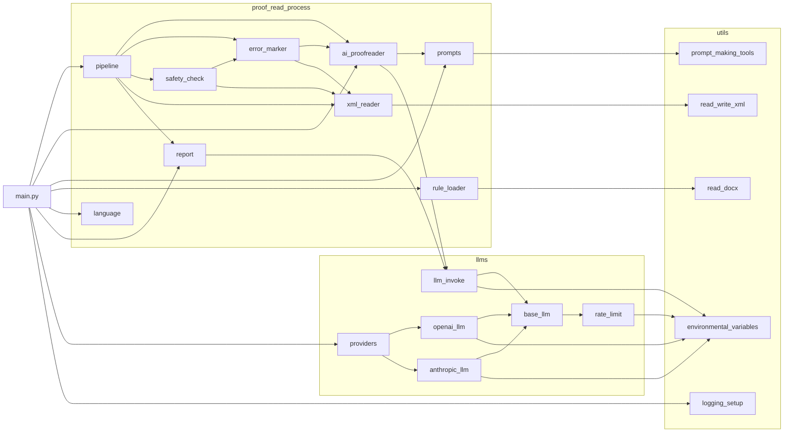
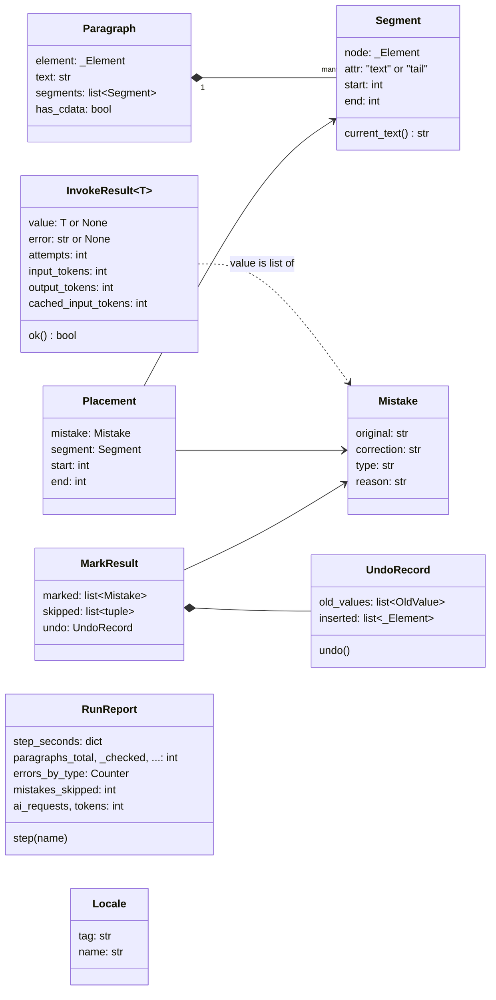

# Codebase guide

A map of the code for developers who need to read, explain or change it.

## Directory map

```text
XML_Proofread/
├── main.py                          command line only
├── proof_read_process/              the proofreading flow
│   ├── language.py                  check --lang, name the language
│   ├── rule_loader.py               .docx style guide -> Markdown
│   ├── prompts.py                   load and fill the prompt templates
│   ├── xml_reader.py                find <p> elements, read their text as Segments
│   ├── ai_proofreader.py            Proofreader.check_all(), parse_ai_answer()
│   ├── error_marker.py              wrap mistakes in <error>, keep an undo record
│   ├── safety_check.py              text unchanged? otherwise undo
│   ├── report.py                    timings, memory, tokens, counts, summary
│   └── pipeline.py                  proofread_file(): the whole flow for one file
├── llms/                            AI clients (no proofreading knowledge)
│   ├── base_llm.py                  ChatLLM.ask(), LLMAnswer, AIError, FatalAIError
│   ├── openai_llm.py                ChatLLM set up for OpenAI
│   ├── anthropic_llm.py             ChatLLM set up for Anthropic
│   ├── providers.py                 create_llm(), PROVIDERS
│   ├── llm_invoke.py                invoke_llm(), invoke_llm_parallel()
│   └── rate_limit.py                wait and retry on HTTP 429
├── utils/
│   ├── read_write_files/
│   │   ├── read_write_xml.py        byte-exact XML load/save
│   │   ├── read_docx.py             .docx paragraphs with style and bold flag
│   │   ├── read_write_md.py         Markdown files
│   │   └── read_write_file.py       read_file()/write_file() by extension
│   ├── prompt_utils/
│   │   └── prompt_making_tools.py   get_prompt(): read a .md template
│   ├── environmental_variables.py   get_variable(), get_int_variable() (.env loaded lazily)
│   └── logging_setup.py             logging to stderr
├── prompt_templates/xml_proofread/
│   ├── system_prompt.md             instructions + style guide + answer format
│   └── user_prompt.md               one paragraph
├── examples/                        example input/output, sample input and real output, Style_Guide.docx
├── tests/                           pytest tests with a fake AI
└── docs/                            this documentation
```

## Module dependencies

Arrows point from a module to the modules it imports.



One thing to notice:

- Nothing in `llms/` imports from `proof_read_process/`. The AI clients can be reused for any
  other task.

## Core data types



| Type | Module | Meaning |
| --- | --- | --- |
| `Locale` | [language.py](../proof_read_process/language.py) | Checked `--lang` tag (`en-US`) and its name (`English (United States)`) |
| `Paragraph` | [xml_reader.py](../proof_read_process/xml_reader.py) | One `<p>` element, its full text and its segments, read before any change |
| `Segment` | [xml_reader.py](../proof_read_process/xml_reader.py) | One piece of paragraph text: `node.text` or `node.tail`, and where it sits in the paragraph text |
| `Mistake` | [ai_proofreader.py](../proof_read_process/ai_proofreader.py) | One mistake from the AI: `original`, `correction`, `type`, `reason` |
| `InvokeResult` | [llm_invoke.py](../llms/llm_invoke.py) | The parsed answer (or the error) for one prompt, plus attempts and tokens. `CheckResult` is `InvokeResult[list[Mistake]]` |
| `LLMAnswer` | [base_llm.py](../llms/base_llm.py) | Raw answer text and token counts from one request |
| `Placement` | [error_marker.py](../proof_read_process/error_marker.py) | Where a mistake was found: its segment and position |
| `MarkResult` / `UndoRecord` | [error_marker.py](../proof_read_process/error_marker.py) | Which mistakes were marked or skipped, and how to undo every change |
| `RunReport` | [report.py](../proof_read_process/report.py) | Every number in the printed summary |
| `XmlFile` | [read_write_xml.py](../utils/read_write_files/read_write_xml.py) | The parsed tree plus the raw bytes before and after the root element |

## Coding rules

The code is meant to be easy for a junior developer to read and explain.

- Python 3.10+, type hints on every function.
- A docstring in simple English on every module, class and function. `ruff` enforces this for
  source code (not for tests).
- Small functions (about 40 lines at most) with clear names, like `find_paragraphs` or
  `mark_errors`.
- `@dataclass` for data, plain functions for logic. No abstract base classes, factories or
  plugin systems.
- Comments explain **why**, not what.
- `logging` for messages. `print` is used only in `report.print_summary()`.
- Clear custom errors (`XmlReadError`, `StyleGuideError`, `AIError`, ...). `main.py` turns the
  expected ones into a one-line message.
- `pathlib.Path` for files. Public functions that take a path accept `str | Path` and convert
  it on their first line.
- Works on Linux, macOS and Windows: no hard-coded `/` or `\`, XML read and written as
  **bytes**, `encoding="utf-8"` whenever text mode is used.
- Prompt templates use `string.Template` (`$name`), not `str.format`, because the prompts
  contain JSON with `{ }`.
- LangChain is used only for the LLM clients. No other frameworks, agents, chains or vector
  databases.
- New dependencies only when clearly needed, added with `uv add`.

Checks:

```bash
uv run pytest -q
uv run ruff check .
uv run ruff format --check .
```

## How to make common changes

### Add an AI provider

1. Write a small `ChatLLM` subclass in `llms/`, like
   [openai_llm.py](../llms/openai_llm.py): pick the model (flag, then `.env`, then a default)
   and build the LangChain chat model with the provider's settings.
2. Add it to `PROVIDERS` in [providers.py](../llms/providers.py). The `--provider` choices come
   from this dictionary.
3. If the provider has its own API key variable, add it to `API_KEY_VARIABLES` so an empty key
   in `.env` is treated as missing.
4. Add tests with a fake chat model in [test_llms.py](../tests/test_llms.py).

### Add a `.env` setting

1. Read it with `get_text_variable()` or `get_int_variable()` from
   [environmental_variables.py](../utils/environmental_variables.py). A bad value logs a
   warning and uses the default.
2. Add it, with its default, to `.env.example`. `test_env_example_matches_the_defaults` fails if
   the two get out of step.
3. Add it to `SETTINGS_TO_RESET` in [conftest.py](../tests/conftest.py) so a developer's own
   `.env` can't change test results.
4. Document it in the README settings table and in [Configuration](configuration.md).

### Change a style rule

Edit the `.docx` style guide. No style rules live in the code: the whole guide is sent to the AI
in the system prompt. See [Style guide handling](style-guide-handling.md).

### Add an error type

1. Add it to `ERROR_TYPES` in [ai_proofreader.py](../proof_read_process/ai_proofreader.py)
   (and any common aliases to `TYPE_ALIASES`).
2. Describe it under "Error types" in
   [system_prompt.md](../prompt_templates/xml_proofread/system_prompt.md).
3. Add tests for `parse_ai_answer()`.

### Change a prompt

1. Edit the Markdown files in `prompt_templates/xml_proofread/`, not Python code.
2. Keep the system prompt the same for every request (for prompt caching). Anything that
   changes per paragraph belongs in `user_prompt.md`.
3. Run the tool on `examples/sample_input.xml` with a real model. The fake-AI tests check the
   templates load and fill, but they can't judge whether the AI answers better.

### Fix a bug

Write a test that shows the bug first, then fix it. Run `pytest` and `ruff` before you finish.
