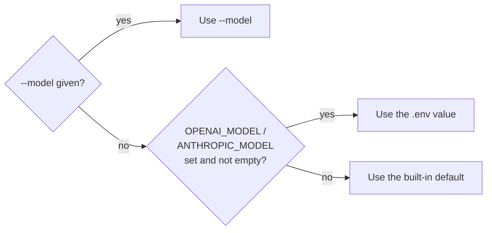
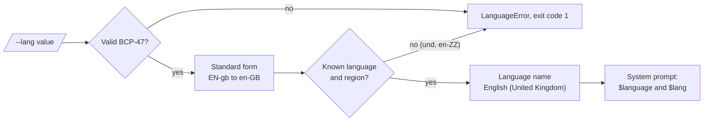

# Configuration

The tool is set up with command-line options and an optional `.env` file. There are no other
config files. For installing and a first run, see the [project README](../README.md#setup).

## Command line

```bash
uv run python main.py <input.xml> --lang <tag> --style-guide <guide.docx> [options]
```

| Option | Required | Meaning |
| --- | --- | --- |
| `input` | yes | The XML file to proofread |
| `--lang` | yes | BCP-47 language tag: `en`, `en-US`, `en-GB`, `fr`, ... |
| `--style-guide` | yes | House style rules as a `.docx` file |
| `--provider` | no | `openai` (default) or `anthropic` |
| `--model` | no | A different model of that provider |
| `--workers` | no | Requests sent at the same time (default `LLM_WORKERS`, or 8) |
| `--verbose` | no | Show debug messages, including per-request HTTP logs |

## `.env` settings

Copy `.env.example` to `.env`. Every setting is optional; a setting left empty uses its
default. Variables already set in the shell win over `.env`.

| Setting | Default | Used by | Meaning |
| --- | --- | --- | --- |
| `OPENAI_API_KEY` | — | OpenAI | API key for `--provider openai` |
| `ANTHROPIC_API_KEY` | — | Anthropic | API key for `--provider anthropic` |
| `OPENAI_MODEL` | `gpt-6.1-terra` | OpenAI | Model, unless `--model` is given |
| `OPENAI_REASONING_EFFORT` | `low` | OpenAI | Thinking effort for reasoning models: `none`, `low`, `medium`, `high`, `xhigh`, `max` |
| `ANTHROPIC_MODEL` | `claude-opus-5-5` | Anthropic | Model, unless `--model` is given |
| `ANTHROPIC_MAX_TOKENS` | `16000` | Anthropic | Most tokens per paragraph (thinking plus answer) |
| `LLM_WORKERS` | `8` | Both | Requests sent at the same time |
| `LLM_MAX_ATTEMPTS` | `3` | Both | Tries per paragraph when the answer can't be parsed |
| `LLM_RATE_LIMIT_RETRIES` | `3` | Both | Waits and retries on "too many requests" (0 = never) |
| `LLM_RATE_LIMIT_WAIT` | `10` | Both | First wait in seconds; doubles each time, max 120 |

A whole-number setting with a bad value (for example `LLM_WORKERS=abc`) logs a warning and uses
the default. An API key left empty is treated as missing.

### Which value wins



The same order applies to `--workers` and `LLM_WORKERS`. For any setting, a variable already
set in the shell wins over the same variable in `.env`.

## Language (`--lang`)

[language.py](../proof_read_process/language.py) checks the tag with `langcodes`:



| `--lang` | Result |
| --- | --- |
| `en` | English. British and American spelling are both accepted |
| `en-US` | English (United States). `organisation` is a spelling error |
| `en-GB` | English (United Kingdom). `organisation` is correct |
| `fr` | French. Only style guide rules that make sense for French are applied |
| `english`, `und`, `en-ZZ` | Rejected with a clear error |

## Output

The marked file is written next to the input: `report.xml` → `report.corrected.xml`. An
existing file with that name is replaced.

A summary is printed to stdout; log messages go to stderr:

```text
Paragraphs: 14 total, 14 checked, 14 with errors
  left unchanged: 0 empty, 0 with CDATA, 0 failed AI requests, 0 undone by the safety check
Errors marked: 47 (clarity 1, grammar 8, punctuation 6, spelling 3, styleguide 29)
Mistakes skipped as unsafe: 0
AI: 14 requests, 14 attempts; tokens: 47,588 in (47,546 cached), 1,741 out
Time: style guide 0.14s, read 0.00s, ai 5.99s, mark 0.00s, save 0.00s; total 6.23s
Peak memory: 197.5 MB process, 4.1 MB Python objects
```

| Line | Meaning |
| --- | --- |
| Paragraphs | All `<p>` elements; how many were checked; how many got at least one `<error>` |
| left unchanged | Empty, containing CDATA, AI request failed, or undone by the safety check |
| Errors marked | `<error>` tags written, by type |
| Mistakes skipped as unsafe | Found by the AI but unsafe to mark (not found, overlap, crosses a tag) |
| AI | Unique texts sent, total attempts (including re-asks), tokens in (cached) and out |
| Time | Seconds per step and in total |
| Peak memory | Whole process (not on Windows) and Python objects |

## Exit codes

| Code | When |
| --- | --- |
| `0` | The run finished. Some paragraphs may still have been left unchanged; see the summary |
| `1` | Bad `--lang`, missing or unreadable input, unreadable style guide, or a fatal AI error (bad API key, no access, unknown model) |
| `2` | Bad command-line arguments (from `argparse`, e.g. an unknown `--provider`) |
