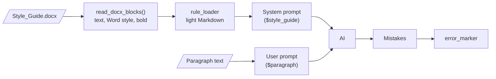

# Style guide handling

The house style guide (`--style-guide`, a `.docx` file) reaches the AI in one way: the
**whole guide** goes in the system prompt. No style rules are written into the code, so any
style guide works without code changes.

## The whole guide in the system prompt

The guide is about 1,500 words (roughly 2,500 tokens), which is small for a modern model.
Sending all of it means no rule can be missed.

Retrieval (RAG, a vector database) is **not** used. A search could miss a rule: for example,
`1930's` might not retrieve the "no apostrophe in plural years" rule. The system prompt is the
same for every request, so prompt caching keeps the full guide fast and cheap.

## Converting `.docx` to Markdown

[rule_loader.py](../proof_read_process/rule_loader.py) reads the guide once per run with
`read_docx_blocks()` ([read_docx.py](../utils/read_write_files/read_docx.py)) and turns each
paragraph into a Markdown line based on its Word style:

| Word style | Markdown |
| --- | --- |
| `Title` | `# Title` |
| `Heading 1`, `PLI_Level 1 Head` | `## Heading` |
| `Heading 2`, `PLI_Level 2 Head` | `### Heading` |
| `PLI_Sample` | `- Example: ...` |
| List styles | `- ...` |
| Fully bold paragraph | `**...**` |
| Anything else | The text as it is |

- Only markers and whitespace are added. The words of the guide never change (a test checks
  this).
- Bold is **not** treated as a heading, because the guide uses bold both for section names and
  for short labels like "Note:".
- Headings let the AI see which rule a line belongs to, so it can name the rule in a
  `styleguide` reason.

Errors (`StyleGuideError`): the file is not `.docx`, can't be read, or has no text.

## The guide and other languages

The guide is written for English, but it is sent for every language. The system prompt tells
the AI to apply each rule only where it makes sense for the `--lang` language; for example,
never to apply the English word list or the "a.m."/"p.m." rule to French text.

## When the style guide changes

The full text is read from the `.docx` every run, so the system prompt updates by itself.
Nothing else needs to change.
