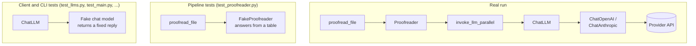

# Testing

The tests never call a real AI. They need no network and no API key.

```bash
uv run pytest -q                 # all tests
uv run ruff check .              # lint
uv run ruff format --check .     # formatting
```

All three must pass before a change is done.

## How the AI is replaced



- **`FakeProofreader`** ([test_proofreader.py](../tests/test_proofreader.py)) stands in for
  `Proofreader.check_all()`. It answers from a table `{piece of paragraph text: [Mistake, ...]}`
  and can be told to fail for some texts. It also records which texts were sent, so tests can
  check that headings and empty paragraphs are never sent.
- **Fake chat models** stand in for `ChatOpenAI` / `ChatAnthropic`, so the real `ChatLLM`,
  `invoke_llm` and `main.py` code runs without a network.
- **[conftest.py](../tests/conftest.py)** runs for every test: it replaces `sleep` in
  `rate_limit.py` (rate-limit tests record the waits instead of waiting) and blanks the
  settings a developer's own `.env` could change.

Tests that write XML use `write_bytes`, because text mode on Windows turns `\n` into `\r\n`.

## Must-keep tests

These protect the golden rules. They must always pass.

| Test | Protects |
| --- | --- |
| `test_example_output_matches_exactly` | The output for `examples/example_input.xml` equals `examples/example_output.xml` byte for byte |
| `test_no_mistakes_gives_byte_identical_file` | No mistakes means the file is unchanged |
| `test_read_then_write_is_byte_identical` | Loading and saving changes nothing |
| `test_namespaces_and_attributes_are_kept` | Namespaces and attributes survive |
| `test_cdata_paragraph_is_skipped_and_kept` | CDATA is never edited |
| `test_unsafe_mistakes_are_skipped_and_text_is_unchanged` | Not found, overlapping and tag-crossing mistakes are skipped |
| `test_failed_ai_request_leaves_paragraph_unchanged` | A failed request never damages a paragraph |
| `test_safety_check_undoes_a_paragraph_whose_text_changed` | The safety check really undoes changes |

`examples/example_output.xml` has no `reason` on its spelling and capitalization errors. That
is because the fake AI in this test leaves those reasons empty; a real AI may add them.

## Test files

| File | Covers |
| --- | --- |
| [test_proofreader.py](../tests/test_proofreader.py) | `proofread_file()` end to end: exact example output, byte-identical files, only `<p>` sent, namespaces, CDATA, inline tags and tails, nested paragraphs, comments, escaping, unsafe mistakes, repeated text, line breaks, failed requests, safety check, empty paragraphs |
| [test_ai_proofreader.py](../tests/test_ai_proofreader.py) | `parse_ai_answer()` (fences, aliases, bad items), `Proofreader.check_all()`, `parse_language()` |
| [test_main.py](../tests/test_main.py) | The command line: a full run, one-line errors, missing input, fatal AI error, unknown provider |
| [test_llms.py](../tests/test_llms.py) | `ChatLLM`, error sorting, stop reasons, OpenAI and Anthropic settings, model choice, `create_llm()`, `.env.example` matches the defaults |
| [test_llm_invoke.py](../tests/test_llm_invoke.py) | Re-asks on unusable answers, parallel calls, fatal errors cancel the rest |
| [test_rate_limit.py](../tests/test_rate_limit.py) | Waits, `Retry-After`, doubling, the 120 s cap |
| [test_read_write_xml.py](../tests/test_read_write_xml.py) | Byte-identical save, XXE safety, character-reference warning, UTF-16 rejected, read/write errors |
| [test_rule_loader.py](../tests/test_rule_loader.py) | `.docx` to Markdown; the guide's words are never changed |
| [test_prompts.py](../tests/test_prompts.py) | The real templates load and fill |
| [test_report.py](../tests/test_report.py) | Report numbers and the printed summary |
| [test_environmental_variables.py](../tests/test_environmental_variables.py), [test_logging_setup.py](../tests/test_logging_setup.py), [test_prompt_making_tools.py](../tests/test_prompt_making_tools.py), [test_read_docx.py](../tests/test_read_docx.py), [test_read_write_md.py](../tests/test_read_write_md.py), [test_utils_files.py](../tests/test_utils_files.py) | The helpers in `utils/` |

## Rules for new tests

- Never call a real API in a test.
- When you fix a bug, write a test that shows it first.
- New behaviour needs a test.
- A new `.env` setting goes into `SETTINGS_TO_RESET` in `conftest.py`.

## What the tests can't check

The fake AI can't judge **how good** the real AI's answers are. After changing a prompt or the
style guide handling, run the tool on `examples/sample_input.xml` with a real model and compare
with `examples/sample_input.corrected.xml`, which is the output of a real `gpt-6.1-terra` run.
