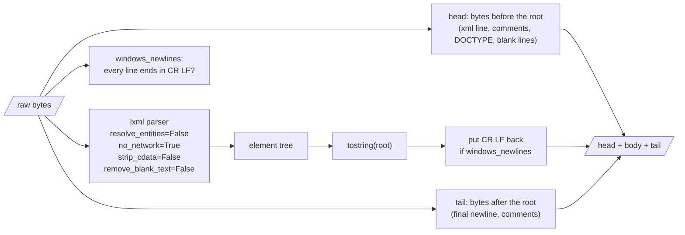
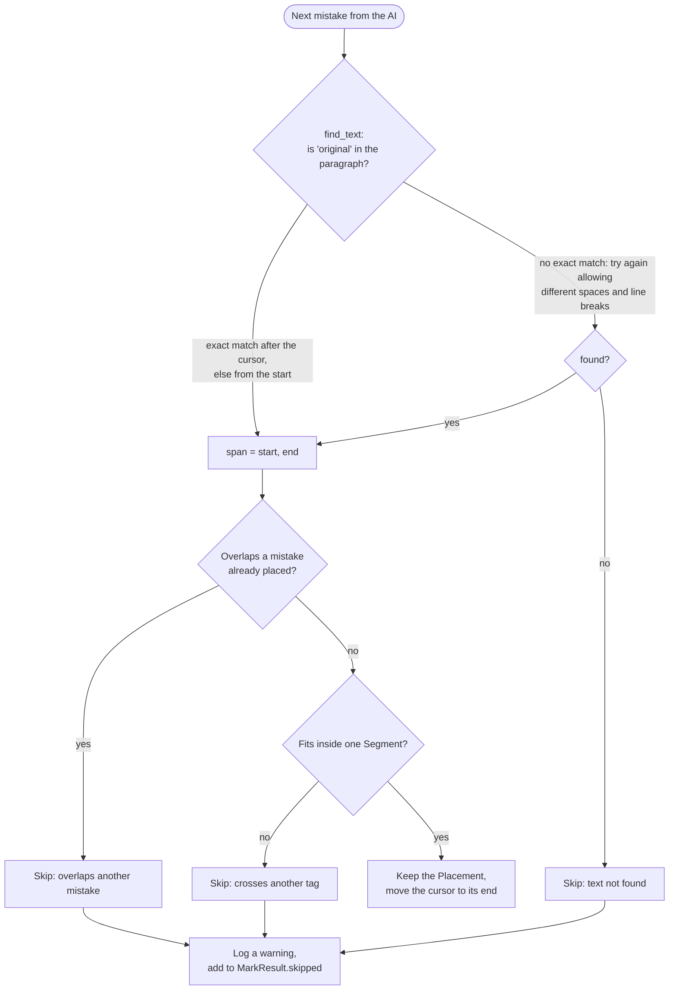
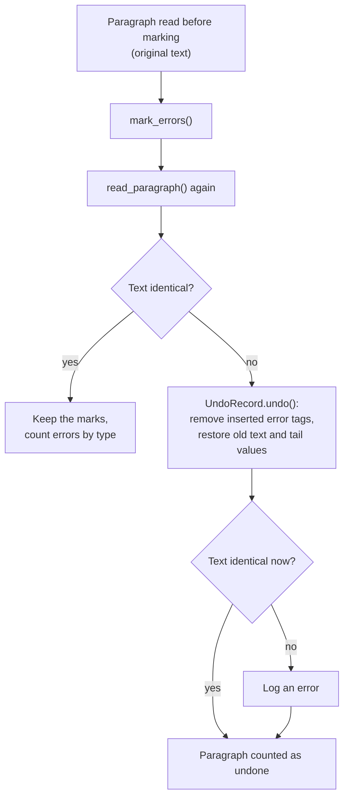
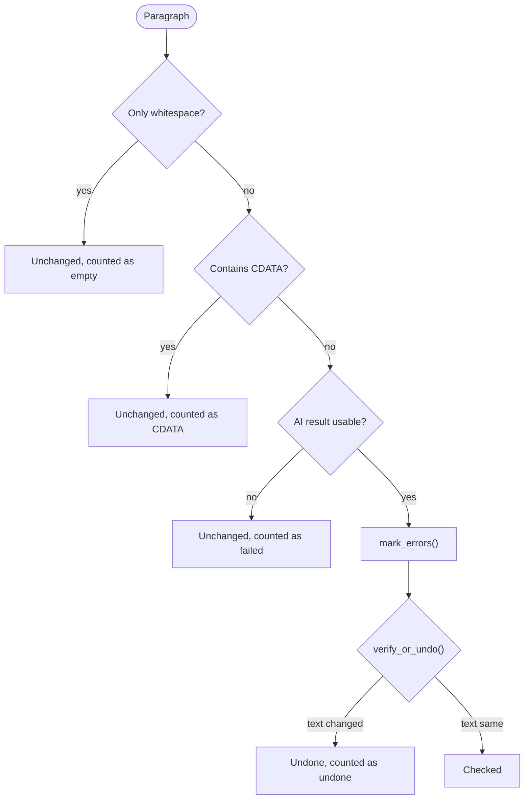

# XML handling and safety

This page explains how paragraph text is read, how `<error>` tags are inserted, and the checks
that make sure the original text is never changed.

## Golden rules

1. **Never change the original text.** Only add `<error>` tags around it. If all `<error>`
   tags are removed, every `<p>` is identical to the input: same characters, same whitespace,
   same length.
2. **The AI never rewrites a paragraph.** It only returns a JSON list of mistakes. Our code
   inserts the tags.
3. **A paragraph with no mistakes stays byte-for-byte identical.**
4. **Everything outside `<p>` stays as it is:** tags, attributes, namespaces, CDATA,
   comments, the `<?xml ...?>` line and whitespace.
5. **If something is unsafe, skip it and log a warning.** Never guess.
6. **One bad paragraph never crashes the program.**

## Loading and saving: byte-exact XML

[read_write_xml.py](../utils/read_write_files/read_write_xml.py) loads and saves XML as
**bytes**, so the encoding and line endings stay as they were.



Why each piece is needed:

| Problem with plain lxml | What we do |
| --- | --- |
| It rewrites the `<?xml ...?>` line (`"` becomes `'`) | Keep the original bytes before the root (`head`) |
| It drops blank lines between top-level nodes and the final newline | Keep the original bytes after the root (`tail`) |
| Every XML parser turns `\r\n` into `\n` | Remember Windows line endings and put them back |
| CDATA would be merged into plain text | `strip_cdata=False` |
| Whitespace between tags could be dropped | `remove_blank_text=False` |
| External entities can read local files or the network (XXE) | `resolve_entities=False`, `no_network=True` |

When the file is loaded, it is saved to bytes once and compared with the input. If they differ,
a warning says the file uses markup lxml can't reproduce.

Known limitations:

- Character references such as `&#x2019;`, single-quoted attributes and `<br></br>` are saved
  as equivalent XML (with a warning), not byte-for-byte.
- UTF-16 and UTF-32 files are rejected with `XmlReadError`.

## Finding paragraphs

`find_paragraphs()` in [xml_reader.py](../proof_read_process/xml_reader.py) walks the whole tree
in document order and returns every `<p>` element, in any namespace, nested ones included. Only
the local name `p` counts, so `<h1>`, `<title>` and other elements are never checked.

## Segments: where paragraph text lives

A `<p>` can contain inline tags, so in lxml its text is split over several places:

- the paragraph's own `.text` (before its first child),
- each child's `.text` (inside the child),
- each child's `.tail` (after the child, still inside the paragraph).

`read_paragraph()` records each piece as a `Segment(node, attr, start, end)`:

```text
<p>Hello <b>big</b> world</p>

paragraph text:  H e l l o _ b i g _ w o r l d
position:        0         6     9           15

Segment(p, "text",  0,  6)   "Hello "
Segment(b, "text",  6,  9)   "big"
Segment(b, "tail",  9, 15)   " world"
```

Rules:

- A mistake can only be wrapped if it fits inside **one** segment. A mistake that crosses
  `<b>` or `</b>` is skipped.
- Text in a **nested** `<p>` belongs to that nested `<p>`, not to the outer one. Only the nested
  paragraph's tail counts for the outer paragraph.
- Comments, processing instructions and entity references are not paragraph text, but the text
  after them (their tail) is.
- A paragraph containing `<![CDATA[...]]>` gets `has_cdata = True` and is skipped completely,
  because editing it would turn the CDATA into ordinary text.

## Marking mistakes

`mark_errors()` in [error_marker.py](../proof_read_process/error_marker.py) works in two steps:
first it finds a safe place for each mistake, then it changes the tree.

### Step 1: place each mistake



Details:

- **Cursor.** The AI lists mistakes in text order, so the search starts after the previous
  mistake. This finds the right copy when the same word appears twice.
- **Loose match.** The AI often writes one space where the XML has a line break and
  indentation. If there is no exact match, the words are matched with any whitespace between
  them. The marked text is still the text from the XML, never the AI's copy.

### Step 2: wrap the text

For each segment that holds mistakes, `wrap_segment()` splits the segment's text and inserts
one `<error>` element per mistake:

```text
before:   p.text = "My name is john."

after:    p.text = "My name is "
          <error type="capitalization" correction="John">john</error>
          error.tail = "."
```

- If the segment is a `.text`, the `<error>` elements go at the start of that node's children.
  If it is a `.tail`, they go right after that node, inside its parent.
- The `<error>` tag is created in the paragraph's namespace, so no stray `xmlns=""` is written.
- Attributes are always in the order `type`, `correction`, `reason`. `reason` is left out when
  it is empty. lxml escapes special characters in attribute values.
- Before any change, the old `.text` or `.tail` value is saved in an `UndoRecord`, and every
  inserted element is listed there too.

## Safety check and undo

After marking, `verify_or_undo()` in [safety_check.py](../proof_read_process/safety_check.py)
reads the paragraph again. `<error>` is now just another inline tag, so its text is part of the
paragraph text. That text must equal the text read before marking.



This check should never fail. It is a guard against bugs, so a mistake in the marking code
can't silently damage a document.

## Per-paragraph decisions



Every branch is counted in the `RunReport` and shown in the printed summary.
